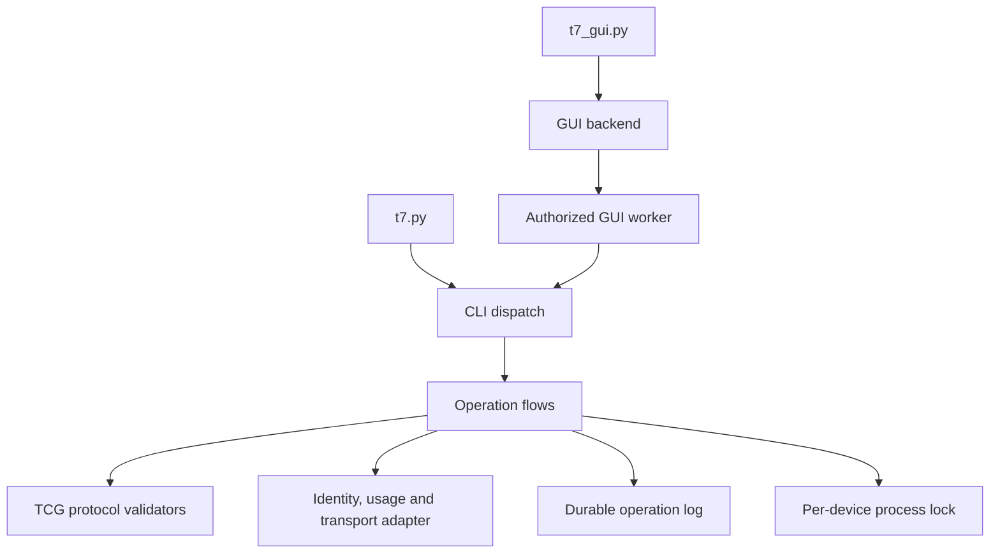

# Source architecture

The application has a shared Python core, a CLI, and an optional PySide6 GUI. Both front ends use the same operation flows and protocol validation.

```text
t7.py                       CLI entry point
t7_gui.py                   GUI entry point
gui_worker.py               Privileged GUI worker with bounded session reuse
t7manager/
  protocol.py               TCG encoding, parsing and response validation
  device.py                 Device identity and generation checks
  safety.py                 Usage, mount and local output checks
  transport.py              Device I/O and user input adapter
  records.py                Atomic operation logs and per-device file lock
  paths.py                  Application-root path policy
  credentials.py            Hidden terminal input
  operations/
    unlock.py               Unlock and status flows
    probe.py                Compatibility and credential-structure queries
    password.py             Password change transaction
    security.py             Initial setup and removal transactions
  cli/
    main.py                 Arguments and dispatch
    i18n.py                 English/Korean presentation
    output.py               Human and JSON results
gui/
  live.py                   Real-device window
  backend.py                Privileged worker communication
  window.py                 Demo and shared details widgets
  details_window.py        Resizable operation details window
  log_viewer.py            Read-only operation log window
  preferences.py           Theme and authorization-session settings
  theme.py                  Themes and icons
  details.py                Human-readable result summaries
  explanations.py          Human-readable failure explanations
  model.py                  Hardware-free simulation
```



The CLI and GUI worker share the same operation code. Passwords enter hidden prompts or the GUI's private stdin pipe, never argv or log fields. The operation flow writes a credential-free checkpoint before each SSD transfer. A first failure stops the flow without automatic retransmission. The OS file lock prevents overlapping processes only while a process runs; prior log files do not block later operations.

`paths.BASE` resolves to the application directory containing `t7.py`. Source-tree runs keep application-relative `state/<device-key>/logs/`, `runs/` and `compatibility-runs/`. An exact `/opt/samsung-t7-ssd-linux/` package installation stores those records under `/var/opt/samsung-t7-ssd-linux/` instead. Existing legacy `pending.json` files are neither read nor modified, and no migration is automatic. Installed records are root-owned and shared across users through the authorized GUI worker; host-preflight failures are displayed but do not create a device log.

The offline suite tests protocol parsing, operation ordering, interruption behavior, logging, CLI output and GUI presentation. Mock responses do not establish additional hardware compatibility or power-loss safety.
